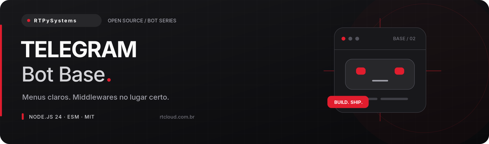

# Telegram Bot Base

**Uma base enxuta para começar direito — e organizada para continuar crescendo.**

Projeto aberto de [RTPySystems](https://github.com/RTPySystems), desenvolvedor e criador da
[RTCloud](https://rtcloud.com.br). Sem arquivos gigantes ou configuração escondida: cada parte
tem seu lugar, do primeiro comando até o encerramento do processo.

[Começar](#começar) · [Configuração](#configuração) · [Estrutura](#estrutura) · [Deploy na RTCloud](#deploy-na-rtcloud) · [Operação](docs/OPERACAO.md)

## O que vem na base

| Recurso                   | Como funciona                                                                                                     |
| ------------------------- | ----------------------------------------------------------------------------------------------------------------- |
| **Experiência pronta**    | Comandos de boas-vindas, ajuda, teste de conexão e um menu com inline keyboards e callbacks confirmados.          |
| **Administração segura**  | Comando restrito a uma lista explícita de IDs. Sem lista configurada, ninguém recebe acesso administrativo.       |
| **Fluxo previsível**      | Middlewares pequenos, limite por usuário, tratamento de erros da API e long polling com parada segura.            |
| **Qualidade e segurança** | ESLint, Prettier, testes com `node:test`, CI configurada, configuração validada e logs sem conteúdo de conversas. |


## Começar

**Requisitos:** Node.js **24.17+ na linha 24 LTS**, npm e uma conta na plataforma do bot.
As dependências estão fixadas e o lockfile acompanha o projeto. Baixe ou clone este repositório,
entre na pasta e execute:

```bash
npm ci
cp .env.example .env
```

No Windows sem Bash, copie `.env.example` para `.env` pelo explorador. Preencha as variáveis
antes de iniciar; **nunca versione o arquivo `.env`**.

1. Abra o [BotFather](https://t.me/BotFather) e crie o bot com `/newbot`.
2. Copie o token para `TELEGRAM_BOT_TOKEN`. Para habilitar `/status`, informe seus IDs numéricos em `TELEGRAM_ADMIN_IDS` — não use `@username`.
3. Inicie com `npm start`, abra a conversa do bot e envie `/start`.

A inicialização registra `/start`, `/help` e `/ping` no menu do Telegram. O `/status` permanece acessível por texto apenas para os IDs autorizados. Esta base usa **long polling**: não precisa de domínio, porta pública ou webhook. Mantenha o modo de privacidade do BotFather habilitado se não precisar receber mensagens comuns de grupos.

> Sem credenciais ou aceite de conexão, `npm start` encerra com uma mensagem em português e código 1.
> Os testes não precisam de tokens nem de uma conexão com a plataforma.

## Comandos

| Comando   | Função                               | Acesso          |
| --------- | ------------------------------------ | --------------- |
| `/start`  | Abre o menu inline.                  | Todos           |
| `/help`   | Mostra o guia de comandos.           | Todos           |
| `/ping`   | Confirma que o bot está respondendo. | Todos           |
| `/status` | Tempo online e memória do processo.  | IDs autorizados |

## Configuração

| Variável               | Obrigatória | Padrão  | Uso                                                        |
| ---------------------- | ----------- | ------- | ---------------------------------------------------------- |
| `TELEGRAM_BOT_TOKEN`   | Sim         | —       | Token emitido pelo BotFather.                              |
| `TELEGRAM_ADMIN_IDS`   | Não         | Vazio   | IDs numéricos separados por vírgula; vazio bloqueia todos. |
| `RATE_LIMIT_MAX`       | Não         | `5`     | Updates aceitos por usuário em cada janela (1–100).        |
| `RATE_LIMIT_WINDOW_MS` | Não         | `10000` | Janela em milissegundos (1000–3600000).                    |
| `LOG_LEVEL`            | Não         | `info`  | Nível de log do Pino.                                      |

O `.env` é carregado pelos scripts `npm start` e `npm run dev`. Na hospedagem, prefira variáveis
no painel. Valores inválidos interrompem a inicialização; nenhuma credencial é incluída na mensagem.

## Estrutura

```text
src/
├── commands/                # comandos públicos e administrativos
├── handlers/                # callbacks e tratamento de erros
├── keyboards/               # construção do menu inline
├── middlewares/             # admin, rate limit e observabilidade
├── lib/                     # configuração, logs e shutdown
├── bot.js                   # composição do pipeline
├── config.js
└── index.js                 # inicialização do long polling
scripts/                     # smoke test sem credenciais
test/                        # updates simulados, API interceptada
```

### Criar seu primeiro comando

Adicione um comando no `Composer` de `src/commands/public.js`:

```js
commands.command('ola', (ctx) => ctx.reply('Olá! Como posso ajudar?'));
```

Para comandos restritos, use `commands.command('nome', adminOnly(adminIds), handler)` no módulo administrativo. Adicione botões em `src/keyboards/` e trate o `callback_data` em `src/handlers/callbacks.js`. Sempre confirme o clique com `ctx.answerCallbackQuery()` antes de fazer trabalho demorado. Se o comando deve aparecer no menu, inclua-o em `setMyCommands` em `src/index.js`.

## Deploy na RTCloud

A [RTCloud](https://rtcloud.com.br) hospeda bots, sites e APIs. O projeto não depende de SDK
proprietário: funciona também em qualquer ambiente compatível com Node.js 24.

1. Valide localmente: `npm run lint && npm test && npm run test:startup`.
2. Envie o código por **GitHub ou ZIP** no fluxo de deploy de bot. Exclua `node_modules`, `.git`, `.env` e sessões do pacote.
3. Selecione **Node.js 24**, instale com `npm ci --omit=dev` e use `npm start` como comando de execução (entrada: `src/index.js`).
4. Cadastre as variáveis da tabela no painel. Nunca coloque tokens no README ou no arquivo de entrada.
5. Abra o console, confira a mensagem de conexão e teste um comando. Esta base é um **worker/bot**, não um site HTTP; não expõe porta pública.

Confira as opções atuais na [documentação da RTCloud](https://docs.rtcloud.com.br).

**Telegram em long polling exige uma única instância por token.** Se houver um webhook configurado anteriormente, remova-o antes de iniciar o polling.

### Usar Docker

```bash
docker build -t telegram-bot-base .
docker run --rm --init --env-file .env telegram-bot-base
```

A imagem usa usuário sem privilégios, instala apenas dependências de produção e trata `SIGTERM`.
Não copie segredos para dentro da imagem. O Dockerfile é uma alternativa ao runtime Node da hospedagem.

## Desenvolvimento e verificação

```bash
npm run dev           # reinicia ao salvar
npm run lint          # ESLint
npm run format:check  # Prettier sem alterar arquivos
npm test              # testes unitários e de integração simulada
npm run test:startup  # valida saída segura sem credenciais
```

Para formatar, use `npm run format`. O workflow em `.github/workflows/ci.yml` executa instalação,
lint, formatação, testes e smoke test em cada push ou pull request. A CI está **configurada**;
a execução na plataforma depende da publicação do repositório.

## Limites e cuidados

O limite usa janela fixa em memória; ele reduz abuso de entrada, mas não substitui os limites de saída da API do Telegram. Sob carga real, use uma fila e respeite `retry_after`. Rode **uma instância por token** em long polling. Não existe banco, persistência de conversas ou armazenamento de dados pessoais nesta base.

Logs são JSON para o console, sem gravar mensagens de usuários. A aplicação omite URL, mensagem
e stack dos erros de bibliotecas para evitar vazamento de credenciais; o tipo do erro permanece
para diagnóstico. Durante a operação, use os códigos e o contexto seguro do evento. `SIGINT` e
`SIGTERM` iniciam um encerramento com prazo de 10 segundos. Falhas fatais encerram com código 1.

## Contribuir e licença

Melhorias são bem-vindas. Veja [CONTRIBUTING.md](CONTRIBUTING.md) antes de abrir um PR.
Licença [MIT](LICENSE) — você pode estudar, adaptar e usar comercialmente, mantendo o aviso da licença.

### Referências técnicas

[Guia do grammY](https://grammy.dev/guide/) · [Tratamento de erros](https://grammy.dev/guide/errors) · [Telegram Bot API](https://core.telegram.org/bots/api)

---

**RTPySystems** · Projetos com propósito, código com estrutura.  
[Perfil](https://github.com/RTPySystems) · [RTCloud](https://rtcloud.com.br) · [Documentação](https://docs.rtcloud.com.br)
